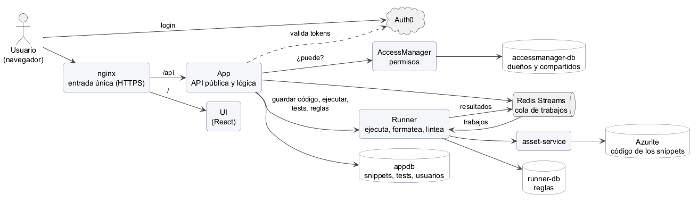
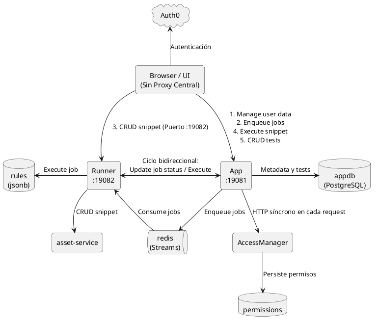
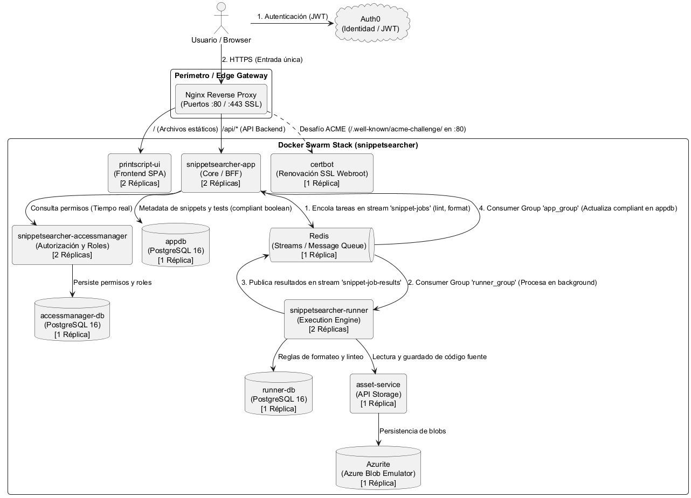
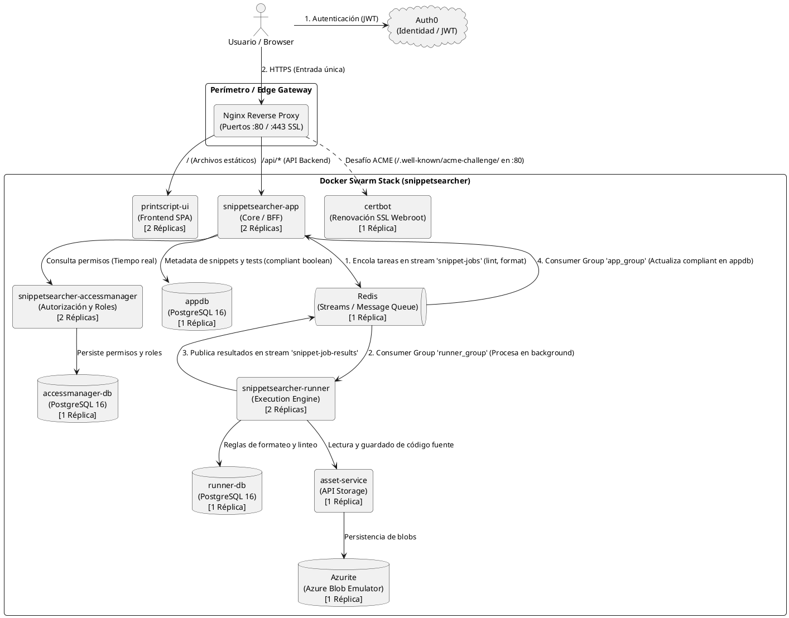
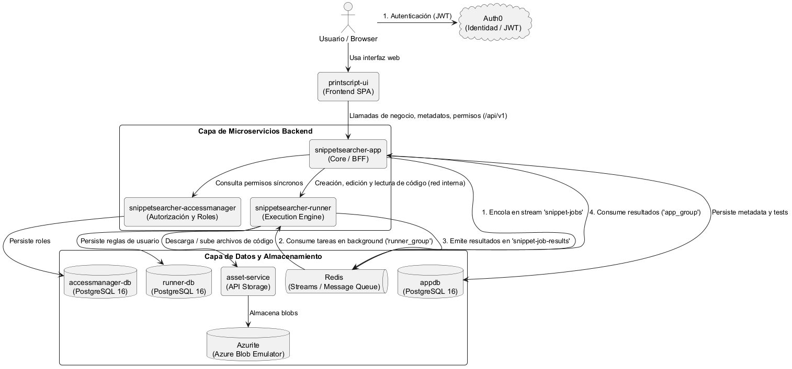
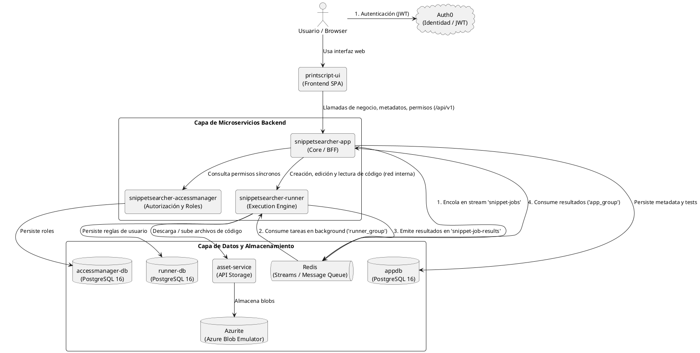

# INFORME DE ANÁLISIS ARQUITECTÓNICO: SNIPPETSEARCHER

## Vista rápida

Los 4 servicios, sus bases y con quién habla cada uno. La UI solo habla con App, a través de nginx. Runner y
AccessManager son internos. Las vistas detalladas están en la [sección 3](#3-arquitectura-nueva-optimizada).



Fuente: [`diagramas/arquitectura_simple.puml`](diagramas/arquitectura_simple.puml). Basado en el `uml_graph` original
de diciembre de 2025, actualizado a la arquitectura actual.

---

## 1. Contexto y Restricciones Obligatorias
El proyecto cuenta con restricciones formales impuestas por el entorno y la cátedra:
* **Cantidad de Microservicios**: Mínimo obligatorio de 3 servicios backend independientes (`App`, `AccessManager`, `Runner`).
* **Base de Datos**: PostgreSQL como base relacional obligatoria.
* **Middleware**: Redis (utilizado **EXCLUSIVAMENTE como Cola de Mensajería / Streams**) y AssetService (Object / Blob Storage para código fuente).
* **Reverse Proxy / Gateway**: Nginx para enrutamiento, terminación SSL, webroot certbot y aislamiento de red.
* **Infraestructura**: Despliegue en Máquinas Virtuales (VMs) Linux mediante **Docker Swarm** (Stacks declarativos con réplicas stateless y balanceo interno) en servidores (`dev` y `prod`), y Docker Compose para desarrollo local.
* **Autenticación**: Auth0 (JWT Bearer tokens y protección de rutas).
* **Monitoreo & Trazabilidad**: New Relic con `-javaagent:newrelic.jar` y correlación continua vía `X-Request-Id`.
* **Objetivo de Diseño**: Lograr máxima cohesión, bajo acoplamiento (principios SOLID), tipado estricto, justificación real de cada componente y extensibilidad multi-lenguaje (PrintScript, Go, Rust, Python).

---

## 2. Diagnóstico de la Arquitectura Actual (Vieja)

En la arquitectura previa, los componentes se comunicaban con acoplamiento cruzado y sin un gateway formal:

### Diagrama PlantUML (Arquitectura Vieja)


### Contras y Problemas Críticos de la Arquitectura Vieja
1. **Frontend como "Orquestador" (Falta de Nginx Reverse Proxy / BFF)**:
   * El cliente web debía conocer dos URLs y puertos distintos (`:19081` para `App` y `:19082` para `Runner`).
   * Para visualizar un snippet, la UI debía orquestar dos peticiones en paralelo (`apiService.getSnippetData` y `runnerService.getSnippetContent`).
2. **Dependencia Circular / Acoplamiento Bidireccional**:
   * `App` llamaba a `Runner` para ejecutar snippets y correr tests, pero al crear un snippet, `Runner` llamaba de regreso a `App` (`appClient.registerSnippet`). Esto generaba ciclos indeseables entre microservicios. Resuelto del todo en noviembre de 2026 (ver sección 3, F).
3. **El caso de testeo de snippets (Teléfono descompuesto de 4 saltos HTTP)**:
   * Al ejecutar un test, `App` consultaba el test en Postgres y se lo enviaba a `Runner` por HTTP; `Runner` tenía que hacer un salto HTTP a `AssetService` para bajarse el código del snippet; luego `Runner` ejecutaba, respondía a `App` y `App` respondía a la UI. Si se corrían 5 tests seguidos, el código se descargaba 5 veces por red.
4. **El antipatrón de `jsonb` ("bjson") y `text[]`**:
   * En `FormattingRule`, `LintingRule` y `Test`, la configuración se guardaba como `columnDefinition = "jsonb"` mapeada a `Map<String, Any>` y los inputs/outputs como `text[]`.
   * **Inconvenientes**: Pérdida total de *Type Safety* en Kotlin, dependencia de sintaxis específica de PostgreSQL (dificultando tests locales en memoria con H2/SQLite) y necesidad de convertidores ad-hoc (`MapJsonConverter`).
5. **`AccessManager` con "Chatty HTTP"**:
   * En cada operación de usuario, `App` hacía llamadas HTTP síncronas a `AccessManager` para evaluar autorizaciones, sumando latencia y creando un punto único de fallo (*Cascading Failures*).
6. **Trazabilidad fragmentada en New Relic**:
   * Como la UI llamaba por separado a `App` y `Runner`, cada llamada recibía un `X-Request-Id` distinto, partiendo las transacciones en árboles desconectados.

---

## 3. Arquitectura Nueva Optimizada

La arquitectura optimizada se detalla en dos vistas complementarias:
1. **Vista de Infraestructura y Producción (Con Nginx Reverse Proxy)**: Con Nginx como Edge Gateway perimetral, terminación SSL y distribución a las 2 réplicas por servicio en Docker Swarm.
2. **Vista Lógica de Microservicios (Sin Nginx)**: Conexiones directas de negocio entre UI, App, Runner, AccessManager, colas y almacenamiento.

---

### A. Vista de Producción y Despliegue (Con Nginx)





---

### B. Vista Lógica de Componentes (Sin Nginx)





### Las Mejoras Fundamentales

#### A. Nginx como Reverse Proxy / API Gateway
* **Seguridad & DMZ**: Oculta la topología interna. Solo los puertos 80 y 443 de Nginx están expuestos a internet; los microservicios corren en una red interna privada.
* **Ruteo de Rutas**: `/api/*` se reenvía a `App` y `/` sirve la SPA de la UI.
* **Terminación SSL & Webroot**: Maneja HTTPS y certificados TLS de Let's Encrypt de forma centralizada con renovación webroot a través de `/var/www/certbot`.

#### B. Redis: Streams de trabajos y estado del linteo
* **Rol:** Redis es el **canal de mensajes** entre App y Runner (Redis Streams) y guarda el **estado de los trabajos de linteo en curso** (`pending` / `failed`).
* **Streams:** `snippet-jobs` (App → Runner, consumer group `runner_group`) y `snippet-job-results` (Runner → App, consumer group `app_group`). Los resultados de linteo y formateo vuelven por Redis, no por HTTP. Las otras llamadas del Runner a App se eliminaron después (ver F).
* **Tolerancia a fallos:** ACK manual (solo si el procesamiento terminó bien), recuperación periódica de mensajes sin confirmar con `XPENDING` + `XCLAIM`, y *dead letter* después de 3 entregas.
* **Compliance:** La tabla `snippet` guarda el resultado definitivo (`compliant` boolean true/false). `pending` y `failed` viven en Redis y la API combina las dos fuentes.

#### C. Engine Central con Plugins en Runner (Strategy Pattern)
* En el Runner se definió la abstracción extensible:
  ```kotlin
  interface LanguageRunner {
      val language: String
      val fileExtension: String
      fun execute(code: String, inputs: List<String>, env: Map<String, String>): ExecutionOutput
      fun format(code: String, rules: Map<String, Any>): String
      fun lint(code: String, rules: Map<String, Any>): LintOutput
  }
  ```
* El `LanguageRunnerRegistry` registra automáticamente los plugins anotados con `@Component` (`PrintScriptLanguageRunner`, etc.), permitiendo extender a nuevos lenguajes sin tocar los controladores (Open/Closed Principle).

#### D. Eliminación de `jsonb`
**Implementado (noviembre 2026):** ya no hay columnas `jsonb`. Detalle en [BASE_DE_DATOS.md](BASE_DE_DATOS.md).
* Reglas de formateo y linteo: una fila por regla en `formatting_rule_values` / `linting_rule_values`, con su tipo
  (`boolean`, `number` o `string`) y clave foránea `ON DELETE CASCADE` a la regla del usuario.
* Variables de entorno de los tests: una fila por variable en `test_environment`, con `ON DELETE CASCADE` a `test`.

**No implementado** de la propuesta original: `in_put`/`out_put` siguen como `text[]` (se leen y escriben siempre
enteros y en orden), y `test` no tiene clave foránea a `snippet` (el borrado en cascada lo hace App).

#### E. Trazabilidad Unificada con New Relic
* El header `X-Request-Id` lo pone nginx (o la UI) y App lo propaga a sus clientes HTTP (`RunnerClient`, `AccessManagerClient`); cada servicio lo guarda en el MDC de sus logs.
* En New Relic, cada petición genera un **Trace Map continuo y unificado** de extremo a extremo.

#### F. Sin dependencia circular entre App y Runner (noviembre 2026)
La dependencia circular de la arquitectura vieja (problema 2 de la sección 2) **se resolvió en dos etapas**:

| Etapa | Qué se resolvió | Qué quedaba |
| :--- | :--- | :--- |
| Redis Streams | Los resultados de linteo y formateo vuelven por `snippet-job-results`, no por HTTP | El Runner seguía llamando a App por HTTP: registrar el snippet al crearlo (`registerSnippet`, justo el problema 2), pedir el linteo después de editar (`lint-jobs`) y correr los tests (`testAll`) |
| App orquesta (13/11/2026) | El Runner ya no llama a App: solo valida, guarda, ejecuta, lintea y formatea lo que App le pide | Nada: las llamadas van en un solo sentido, UI → App → Runner |

**Cómo es ahora:** al crear o editar, App le pide al Runner que valide y guarde el código. Con la respuesta, App
registra los metadatos y el dueño, encola el linteo y corre los tests (una llamada al Runner por test).

**Qué se ganó:**
- **Consistencia:** si el registro falla, App borra el código recién guardado y no queda huérfano en el bucket. Al
  editar, el estado de linteo anterior se invalida (`compliant = null`) y, si encolar falla, lo retoma el reconciliador.
- **Seguridad:** desaparecieron la ruta sin token `/internal/snippets/{id}` y el reenvío del token del usuario al Runner.
- **Menos carga:** App atiende un solo pedido por guardado, en lugar del pedido original más las llamadas de vuelta.

Se borraron el `AppClient` del Runner, `InternalSnippetController` y el endpoint `POST .../lint-jobs` de App.

---

## 4. Cuadro Comparativo: Pros y Contras

| Aspecto | Arquitectura Vieja | Arquitectura Nueva (Actual) |
| :--- | :--- | :--- |
| **Proxy Exterior** | **Contras**: Sin proxy central. El navegador interactuaba directamente con puertos de microservicios (`:19081`, `:19082`). | **Pros (Nginx)**: Proxy inverso único en puertos 80/443. Aísla la red interna, maneja SSL y rutea tráfico. |
| **Punto de Contacto de la UI** | **Contras**: La UI debía coordinar llamadas a `App` y `Runner` expuestos a internet. | **Pros**: Entrada única por dominio HTTPS (`/api/`). Runner y AccessManager solo en la red interna. |
| **Rol de Redis** | Sin uso claro o mezclado. | **Pros (Cola Pura)**: EXCLUSIVAMENTE cola de mensajería (Redis Streams) para linteo y formateo masivo tolerante a fallos. |
| **Políticas de Autorización** | Chatty HTTP con posible inconsistencia. | **Pros**: Consulta directa en tiempo real a `AccessManager`. Cero datos obsoletos (*zero stale permissions*). |
| **Soporte de Lenguajes** | PrintScript hardcodeado dentro del Runner. | **Pros**: Engine Central con Plugins (`LanguageRunner`). Soporta Python, Go o Rust mediante Strategy Pattern. |
| **Persistencia de Reglas** | Uso de `jsonb` en Postgres con `Map<String, Any>` sin tipado. | **Pros**: Una fila por regla, con su tipo, e integridad referencial `ON DELETE CASCADE`. Sin `jsonb`. |
| **Trazabilidad New Relic** | Trazas partidas en árboles independientes. | **Pros**: Traza distribuida continua y unificada con correlación por `X-Request-Id` de punta a punta. |
| **Cantidad de Microservicios** | 3 servicios desbalanceados y riesgo de un 4to innecesario. | **3 servicios justificados y balanceados**: Negocio/BFF (`App`), Seguridad/Políticas (`AccessManager`) y Cómputo/Sandbox (`Runner`). |

---

## 5. Guía: Cómo Agregar un Nuevo Lenguaje (ej. Python o Go)

Gracias al patrón Strategy y al Engine Central, agregar un lenguaje solo requiere 3 pasos:

1. **Crear el Plugin en `SnippetSearcher-Runner`**:
   Crear una clase anotada con `@Component` que implemente `LanguageRunner` (ej. `PythonLanguageRunner` ejecutando `ProcessBuilder("python3")`).
2. **Instalar el Compilador/Runtime en el `Dockerfile` de `Runner`**:
   Agregar `RUN apt-get update && apt-get install -y python3 python3-pip && pip install black flake8`.
3. **Cero cambios en el resto del sistema**:
   `App`, `AccessManager`, `AssetService` y `PostgreSQL` no requieren modificaciones. Solo se agrega el lenguaje en el selector de la UI.

---

## 6. Estándares de Ingeniería de Código y Convenciones Gradle
Para garantizar calidad homogénea y evitar duplicación entre los microservicios backend (`App`, `AccessManager`, `Runner`):
* **Convention Plugin (`myPlugin`)**: Implementado en `buildSrc/` en cada microservicio, centralizando la configuración de Kotlin, Ktlint, Detekt y JaCoCo. Al compilar emite `>>>>> myPlugin is working <<<<<`.
* **Formateo y Linteo**: Reglas unificadas vía `.editorconfig` (Ktlint) y `config/detekt/detekt.yml` (Detekt 1.23.8), heredadas directamente de PrintScript.
* **Pre-commit Hook**: Script `.githooks/pre-commit` y tarea `installGitHook` que bloquea commits que incumplan formato, linteo, pruebas unitarias o cobertura.
* **Verificación en CI/CD**: Pasos remotos idénticos en `.github/workflows/ci-cd.yml` de cada microservicio previo a la construcción de contenedores Docker.
* Para el detalle exhaustivo, consultar [Calidad, Linter, Formateador y CI/CD](CALIDAD_LINTER_FORMATTER_CI.md).

---

## 7. Estrategia de Versionado y Tags en Docker Registry (GHCR)
Para balancear la automatización de despliegues y la trazabilidad inmutable:
* **Doble Tagging en CI/CD**: Cada imagen se publica con un tag inmutable con el SHA del commit (`:<ambiente>-<commit>`), que es el que `update-infra` escribe en `docker-stack.yml` y Swarm despliega, y con un tag de ambiente flotante (`:develop` o `:production`) que apunta a la última imagen.
* **Trazabilidad y Rollbacks**: Los tags con commit generan enlaces directos al commit en la interfaz de GitHub Packages, y volver a una versión exacta es revertir su commit en la rama de Infra.
* Para el detalle exhaustivo, consultar [Estrategia de Tags Docker](ESTRATEGIA_TAGS_DOCKER.md).
