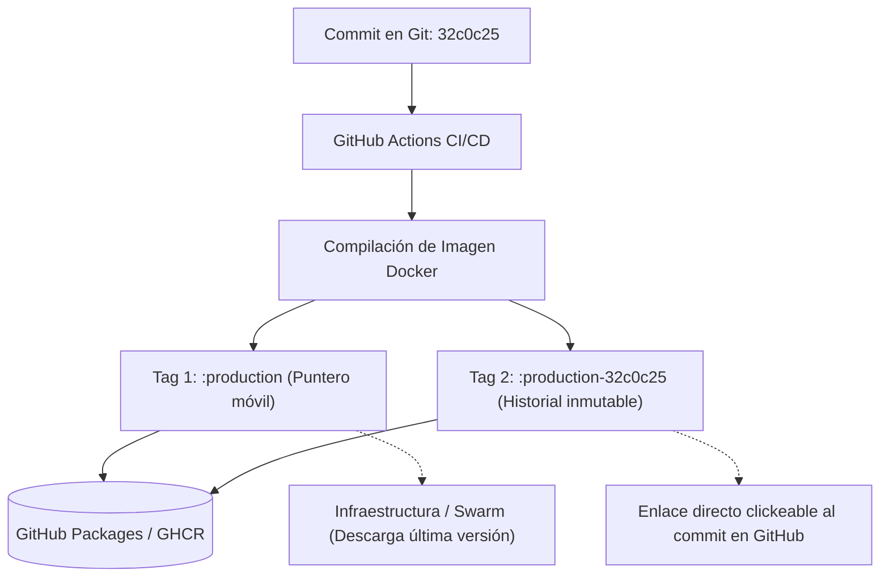

# Estrategia de Versionado y Etiquetado de Imágenes Docker (Tags)

Este documento detalla la arquitectura de etiquetado (tagging) de contenedores en **GitHub Container Registry (GHCR)** para los microservicios del ecosistema `SnippetSearcher` (`snippetsearcher-app`, `snippetsearcher-runner`, `snippetsearcher-accessmanager` y `printscript-ui`), analizando sus ventajas, desventajas, funcionamiento interno y cómo interactúa con el despliegue en producción y desarrollo.

---

## 1. La Problemática Inicial: El Tag Mutable (`:branch`)

En la configuración inicial, cada pipeline de CI/CD publicaba únicamente una etiqueta basada en la rama:
* `:develop`
* `:production`

### ¿Qué ocurría en GitHub Packages?
1. **Sobrescritura continua de la etiqueta**: Cada vez que se compilaba un commit en `production`, la etiqueta `:production` se desasociaba de la imagen anterior y apuntaba a la nueva.
2. **Imágenes huérfanas sin tag (Dangling / Untagged)**: Las versiones anteriores no se eliminan físicamente de GHCR, pero al perder la etiqueta, pasan a listarse únicamente por su hash binario (`sha256:cc41e8ef...`).
3. **Pérdida de trazabilidad**: Al ver una lista de versiones llamadas `sha256:...`, no hay forma de saber qué código contenía cada una, ni a qué commit correspondía, impidiendo un rollback manual certero.
4. **Confusión entre Docker Digest y Git SHA**:
   * **Docker Layer Digest (`sha256:...`)**: Suma criptográfica calculada por el daemon de Docker a partir de las capas binarias. No tiene relación con Git.
   * **Git Commit SHA (`32c0c25...`)**: Hash de Git calculado a partir del árbol de código, autor y mensaje de commit.

---

## 2. La Solución Adoptada: Doble Etiquetado (`:rama` + `:rama-commit`)

Para mantener lo mejor de ambos mundos sin romper la automatización existente, los workflows de CI/CD publican **dos etiquetas en simultáneo** para cada imagen compilada:

1. **Tag de Ambiente (Flotante / Mutable)**:
   * Ejemplo: `ghcr.io/grupo-14-ingsis/snippetsearcher-app:production`
   * *Propósito*: Sirve como puntero automático a la **última versión estable**. Permite que la infraestructura (`update_service.yml` / Docker Swarm) descargue siempre la última versión sin necesidad de modificar archivos YAML en cada deploy.
2. **Tag Inmutable de Trazabilidad (`<rama>-<commit>`)**:
   * Ejemplo: `ghcr.io/grupo-14-ingsis/snippetsearcher-app:production-32c0c25a8f...` (o `develop-<sha>`)
   * *Propósito*: Deja una instantánea permanente en el historial de GHCR.



---

## 3. Ventajas y Desventajas (Pros y Contras)

### Ventajas (Pros)
* **Trazabilidad 100% directa y visual**: En la interfaz web de GitHub Packages, al incluir el SHA del commit en el nombre del tag, GitHub lo reconoce y genera un **enlace directo clickeable al commit** en el repositorio.
* **Rollback trivial y seguro**: Si un deploy en producción falla, se puede revertir el servicio en el Swarm inmediatamente a una versión específica conocida:
  ```bash
  docker service update --image ghcr.io/grupo-14-ingsis/snippetsearcher-app:production-<commit_anterior> snippetsearcher_snippetsearcher-app
  ```
* **Compatibilidad retroactiva total**: El workflow de infraestructura (`update_service.yml`) y el despliegue continuo **no requieren cambios**, ya que siguen escuchando y descargando el tag `:production` o `:develop`.
* **Diferenciación clara de ambientes**: Al usar `<rama>-<commit>` en lugar de solo `<commit>`, se distingue de un vistazo si una imagen fue generada para `develop` o para `production`.

### Desventajas (Contras) y Mitigaciones
* **Espacio acumulado en GHCR**: Al mantener identificadas múltiples versiones, el listado de imágenes crece a lo largo del tiempo.
  * *Mitigación*: GitHub Packages ofrece políticas de retención (*Package retention rules*) para eliminar automáticamente tags inmutables viejos.
* **Tiempo adicional despreciable de push**: Se envía un tag adicional a GHCR en cada pipeline (< 1 segundo porque las capas binarias son idénticas).

---

## 4. Implementación en los Workflows de CI/CD

### En servicios con comando Docker directo (`SnippetSearcher-App` y `printscript-ui`)
```yaml
- name: Build and push Docker image
  run: |
    branch=${GITHUB_REF_NAME}
    commit_sha=${GITHUB_SHA}
    docker build \
      -t ghcr.io/grupo-14-ingsis/snippetsearcher-app:$branch \
      -t ghcr.io/grupo-14-ingsis/snippetsearcher-app:$branch-$commit_sha .
    docker push ghcr.io/grupo-14-ingsis/snippetsearcher-app:$branch
    docker push ghcr.io/grupo-14-ingsis/snippetsearcher-app:$branch-$commit_sha
```

### En servicios con `docker/build-push-action` (`SnippetSearcher-Runner` y `SnippetSearcher-AccessManager`)
```yaml
- name: Build and push Docker image
  uses: docker/build-push-action@v5
  with:
    context: .
    file: ./Dockerfile
    push: true
    tags: |
      ghcr.io/grupo-14-ingsis/snippetsearcher-runner:${{ github.ref_name }}
      ghcr.io/grupo-14-ingsis/snippetsearcher-runner:${{ github.ref_name }}-${{ github.sha }}
```

---

## 5. Resolución de Digest en Despliegue Automático (`update_service.yml`)

Para evitar que Swarm reutilice una imagen cacheada localmente en el nodo y garantice la descarga de la nueva versión:
1. El workflow resuelve el **digest SHA256** exacto en el runner de GitHub Actions usando `docker buildx imagetools inspect`:
   ```bash
   DIGEST="$(docker buildx imagetools inspect "$IMAGE_URI" --format '{{json .Manifest}}' | jq -r .digest)"
   ```
2. Actualiza el servicio en la VM pineando el digest mediante SSH (`DOCKER_HOST=ssh://vm`):
   ```bash
   docker service update --with-registry-auth --image "${IMAGE_URI}@${DIGEST}" "snippetsearcher_${SERVICE_NAME}"
   ```
3. Verifica que la tarea en ejecución coincida con el digest solicitado; si Swarm hace rollback por falla de arranque, el pipeline falla en rojo inmediatamente.
