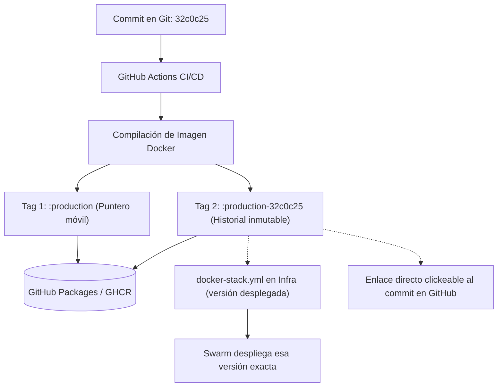

# Estrategia de Versionado y Etiquetado de Imágenes Docker (Tags)

Este documento detalla la arquitectura de etiquetado (tagging) de contenedores en **GitHub Container Registry (GHCR)** para los microservicios del ecosistema `SnippetSearcher` (`snippetsearcher-app`, `snippetsearcher-runner`, `snippetsearcher-accessmanager` y `printscript-ui`), analizando sus ventajas, desventajas, funcionamiento interno y cómo interactúa con el despliegue en producción y desarrollo.

---

## 1. La Problemática Inicial: El Tag Mutable (`:branch`)

En la configuración inicial, cada pipeline de CI/CD publicaba únicamente una etiqueta basada en la rama:
* `:develop`
* `:production`

### ¿Qué ocurría en GitHub Packages?
1. **Sobrescritura continua de la etiqueta**: Cada vez que se compilaba un commit en `production`, la etiqueta `:production` se desasociaba de la imagen anterior y apuntaba a la nueva.
2. **Imágenes huérfanas sin tag (Dangling / Untagged)**: Las versiones anteriores no se eliminan físicamente de GHCR, pero al perder la etiqueta, pasan a listarse únicamente por su hash binario (`sha256:cc41e8ef...`).
3. **Pérdida de trazabilidad**: Al ver una lista de versiones llamadas `sha256:...`, no hay forma de saber qué código contenía cada una, ni a qué commit correspondía, impidiendo un rollback manual certero.
4. **Confusión entre Docker Digest y Git SHA**:
   * **Docker Layer Digest (`sha256:...`)**: Suma criptográfica calculada por el daemon de Docker a partir de las capas binarias. No tiene relación con Git.
   * **Git Commit SHA (`32c0c25...`)**: Hash de Git calculado a partir del árbol de código, autor y mensaje de commit.

---

## 2. La Solución Adoptada: Doble Etiquetado (`:rama` + `:rama-commit`)

Los workflows de CI/CD publican **dos etiquetas en simultáneo** para cada imagen compilada:

1. **Tag Inmutable (`<ambiente>-<commit>`)**:
   * Ejemplo: `ghcr.io/grupo-14-ingsis/snippetsearcher-app:production-32c0c25a8f...` (o `develop-<sha>`)
   * *Propósito*: Es **el que se despliega**. El job `update-infra` lo escribe en `docker-stack.yml`, así que la versión de cada ambiente queda registrada en Git.
2. **Tag de Ambiente (Flotante / Mutable)**:
   * Ejemplo: `ghcr.io/grupo-14-ingsis/snippetsearcher-app:production`
   * *Propósito*: Apunta siempre a la **última imagen publicada** en ese ambiente. El stack no lo usa; sirve para bajar la última versión a mano.



---

## 3. Ventajas y Desventajas (Pros y Contras)

### Ventajas (Pros)
* **Trazabilidad 100% directa y visual**: En la interfaz web de GitHub Packages, al incluir el SHA del commit en el nombre del tag, GitHub lo reconoce y genera un **enlace directo clickeable al commit** en el repositorio.
* **Rollback trivial y seguro**: Si un deploy falla, se revierte en la rama de Infra el commit `chore: update Docker image ...`:
  ```bash
  git revert <commit>
  git push
  ```
  El push dispara `deploy.yml` y vuelve a la versión anterior. La imagen tiene que seguir en GHCR.
* **Historial de versiones en Git**: Cada deploy es un commit en Infra, y `docker-stack.yml` muestra qué versión corre en cada ambiente.
* **Diferenciación clara de ambientes**: Al usar `<rama>-<commit>` en lugar de solo `<commit>`, se distingue de un vistazo si una imagen fue generada para `develop` o para `production`.

### Desventajas (Contras) y Mitigaciones
* **Espacio acumulado en GHCR**: Al mantener identificadas múltiples versiones, el listado de imágenes crece a lo largo del tiempo.
  * *Mitigación*: GitHub Packages ofrece políticas de retención (*Package retention rules*) para eliminar automáticamente tags inmutables viejos.
* **Tiempo adicional despreciable de push**: Se envía un tag adicional a GHCR en cada pipeline (< 1 segundo porque las capas binarias son idénticas).

---

## 4. Implementación en los Workflows de CI/CD

Los cuatro repos publican las dos etiquetas con `docker/build-push-action`. Los nombres de las ramas no coinciden entre repos, así que el paso `Store new image version` calcula tres valores:

```yaml
- name: Store new image version
  id: version
  run: |
    echo "version=${GITHUB_REF_NAME}-${GITHUB_SHA}" >> "$GITHUB_OUTPUT"

    # Las ramas no se llaman igual: este repo usa develop/production e Infra usa develop/main
    if [[ "$GITHUB_REF_NAME" == "production" ]]; then
    echo "branch=production" >> "$GITHUB_OUTPUT"
    echo "infra_branch=main" >> "$GITHUB_OUTPUT"
    else
    echo "branch=develop" >> "$GITHUB_OUTPUT"
    echo "infra_branch=develop" >> "$GITHUB_OUTPUT"
    fi

- name: Build and push Docker image
  uses: docker/build-push-action@v5
  with:
    context: .
    file: ./Dockerfile
    push: true
    tags: |
      ghcr.io/grupo-14-ingsis/snippetsearcher-runner:${{ steps.version.outputs.branch }}
      ghcr.io/grupo-14-ingsis/snippetsearcher-runner:${{ steps.version.outputs.version }}
```

| Push a | Tag móvil | Tag fijo | Rama de Infra |
| :--- | :--- | :--- | :--- |
| `develop` | `:develop` | `:develop-<sha>` | `develop` |
| `production` | `:production` | `:production-<sha>` | `main` |

---

## 5. Resolución de Digest en el Despliegue (`deploy.yml`)

1. `docker stack deploy --resolve-image always` traduce cada tag de `docker-stack.yml` a su **digest SHA256** antes de actualizar los servicios.
2. La verificación lee de `docker-stack.yml` la imagen de cada servicio y resuelve su digest en el runner:
   ```bash
   image="$(grep -E "^[[:space:]]*image:[[:space:]]*ghcr\.io/grupo-14-ingsis/${repo}:" docker-stack.yml | awk '{print $2}')"
   digest="$(docker buildx imagetools inspect "$image" --format '{{json .Manifest}}' | jq -r .digest)"
   ```
3. Espera hasta que todas las réplicas corran ese digest. Si Swarm hace rollback por una falla de arranque, el pipeline falla en rojo. Recién después se ejecuta `docker image prune`.
