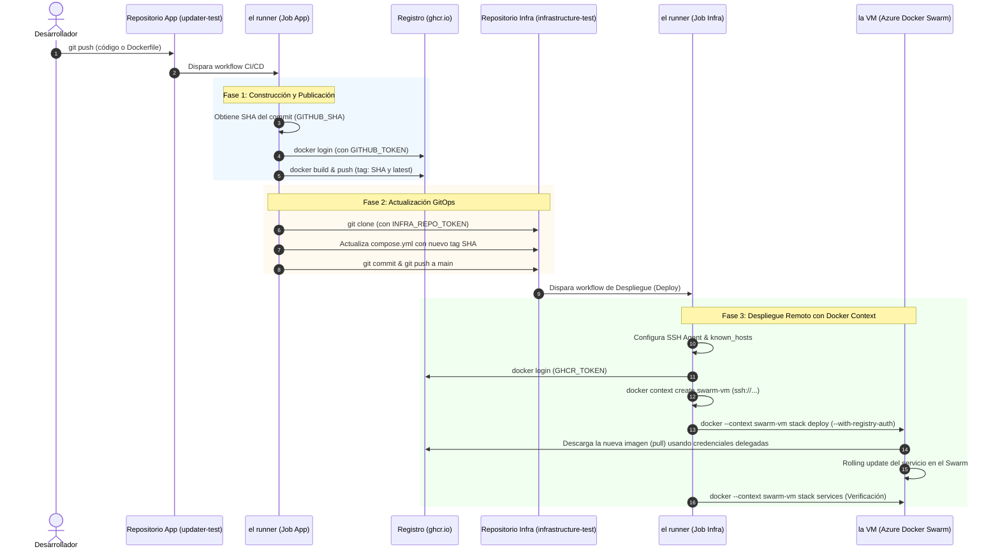

# Reporte Técnico: Despliegue Automático con Docker Swarm y Docker Context

> **Estado del Proyecto:** Sandbox / Prueba de Concepto (PoC)  
> **Destinatarios:** Equipo de Desarrollo, DevOps y Arquitectura de Microservicios  
> **Objetivo:** Describir en detalle el funcionamiento del pipeline de despliegue continuo (CD) basado en el patrón GitOps utilizando GitHub Actions, Docker Context y Docker Swarm, sirviendo como guía para su adopción en un sistema de microservicios.

---

## 1. Glosario y Convención de Nomenclatura

Para garantizar una lectura unívoca de este documento, se definen a continuación los términos clave utilizados a lo largo del reporte:

*   **el runner:** Máquina virtual efímera basada en Ubuntu Linux provista por la plataforma GitHub Actions en la nube. En ella se ejecutan los scripts, compilaciones de imágenes y comandos de despliegue definidos en los flujos de trabajo (*workflows*).
*   **la VM:** Máquina virtual alojada en Microsoft Azure en la que reside el demonio de Docker (*Docker Engine*) y donde opera el clúster de Docker Swarm. Es el servidor destino donde se ejecutan los contenedores de la aplicación en producción/sandbox.
*   **Docker Context:** Mecanismo y funcionalidad provista por el CLI de Docker que permite conmutar el destino de los comandos de Docker. En este flujo, permite que el cliente de Docker ejecutado en **el runner** envíe instrucciones seguras al demonio de Docker en **la VM** a través de un túnel SSH, sin exponer puertos TCP inseguros a internet.
*   **Docker Swarm:** Modo de orquestación nativo integrado en Docker Engine que agrupa una o más máquinas (nodos) para desplegar, balancear y gestionar de forma declarativa el ciclo de vida de contenedores.
*   **Stack:** Conjunto interrelacionado de servicios de Docker Swarm declarados mediante un archivo Compose (`compose.yml`) que comparten redes, volúmenes y políticas de escalado.
*   **GHCR (GitHub Container Registry):** Servicio SaaS de registro de artefactos OCI provisto por GitHub (`ghcr.io`) para el almacenamiento, versionado y distribución de imágenes de Docker.
*   **GitOps:** Patrón de arquitectura donde un repositorio Git actúa como la "única fuente de la verdad" (*Single Source of Truth*) para la definición del estado deseado de la infraestructura y las aplicaciones.

---

## 2. Tecnologías, Protocolos y Funciones Utilizadas

### 2.1. Tecnologías
*   **Docker Engine y Docker Buildx:** Herramientas para la compilación optimizada y empaquetado de contenedores mediante capas OCI.
*   **Docker CLI con Docker Context:** Interfaz de línea de comandos que permite gestionar instancias remotas de Docker sin necesidad de reconfigurar variables de entorno globales como `DOCKER_HOST`.
*   **Docker Swarm (`docker stack`):** Motor de orquestación declarativa que garantiza que el estado real de la infraestructura coincida con el especificado en `compose.yml`.
*   **Git y GitHub:** Control de versiones distribuido y plataforma de integración continua.
*   **Bash (`sed`, `grep`, `ssh-keyscan`, `chmod`):** Herramientas estándar de Linux empleadas en **el runner** para inspeccionar archivos, reemplazar versiones y gestionar llaves criptográficas.

### 2.2. Protocolos de Comunicación
*   **SSH (Secure Shell - Puerto TCP 22):**
    *   **Uso:** Canal cifrado establecido entre **el runner** y **la VM**.
    *   **Función:** Docker Context monta la comunicación del API del Docker Engine sobre este túnel seguro mediante el esquema `ssh://usuario@host`, eliminando el riesgo crítico de abrir el socket de Docker (`2375` o `2376`) directamente a internet.
*   **HTTPS / TLS (Puerto TCP 443):**
    *   **Uso:** Protocolo de transporte seguro utilizado para la interacción con la API de GitHub, clonación y envío de commits vía Git, y subida/bajada de capas de imágenes Docker en `ghcr.io`.
*   **HTTP (Puerto TCP 80 / 8080):**
    *   **Uso:** Protocolo a nivel de aplicación expuesto por el microservicio en **la VM** para servir peticiones web a los usuarios finales.

### 2.3. Funciones Clave del Flujo
*   **Tagging Inmutable con `${GITHUB_SHA}`:** Evita el uso exclusivo del tag mutable `latest`. Cada compilación genera una imagen asociada al identificador SHA del commit, lo cual garantiza trazabilidad, reproducibilidad y despliegues sin problemas de caché.
*   **Reemplazo Declarativo Automatizado (`sed`):** **El runner** del repositorio de aplicación actualiza automáticamente el manifiesto central de infraestructura (`compose.yml`) reflejando la nueva versión inmutable de la imagen.
*   **Delegación de Credenciales (`--with-registry-auth`):** Función de Docker Swarm que toma las credenciales del registro (GHCR) autenticadas en el cliente (**el runner**) y las transfiere temporalmente y de forma segura al Swarm Manager en **la VM**. Esto permite a **la VM** descargar imágenes privadas sin necesidad de almacenar credenciales o tokens permanentes en su disco.

---

## 3. Arquitectura y Topología del Pipeline

La arquitectura se compone de dos repositorios desacoplados que interactúan bajo el modelo GitOps:

1.  **Repositorio del Microservicio (`updater-test`):** Contiene el código fuente de la aplicación, el `Dockerfile` y el flujo de integración continua (CI) y actualización de versión.
2.  **Repositorio de Infraestructura (`infrastructure-test`):** Contiene el archivo de definición del clúster (`compose.yml`) y el flujo de despliegue continuo (CD) hacia **la VM**.

### Diagrama de Flujo y Comunicación



---

## 4. Explicación Detallada de los Workflows

### 4.1. Repositorio de la Aplicación (`updater-test/.github/workflows/update-repository.yml`)

Este flujo se ejecuta ante cualquier evento `push` en el repositorio de la aplicación y se divide en dos *jobs* secuenciales:

#### Job 1: `create-new-docker-image`
*   **Entorno:** Se ejecuta en **el runner** (`ubuntu-latest`).
*   **Paso 1 (Checkout):** Clona el código fuente del microservicio mediante `actions/checkout@v4`.
*   **Paso 2 (Store new image version):** Guarda el SHA del commit actual (`GITHUB_SHA`) en una variable de salida del job (`outputs.image_version`). Esto asegura que la versión sea única e inmutable.
*   **Paso 3 (Log in to GHCR):** Inicia sesión en `ghcr.io` utilizando la acción oficial `docker/login-action@v3` y el token efímero automático `${{ secrets.GITHUB_TOKEN }}`.
*   **Paso 4 (Build and push Docker image):** Utiliza `docker/build-push-action@v5` para compilar la imagen a partir del `Dockerfile` local y la publica en GHCR con dos etiquetas:
    *   `ghcr.io/sannnn-sannnn/updatertest:latest`
    *   `ghcr.io/sannnn-sannnn/updatertest:<GITHUB_SHA>`

#### Job 2: `update-infra`
*   **Entorno:** Se ejecuta en **el runner** (`ubuntu-latest`), sujeto a la finalización exitosa del Job 1 (`needs: create-new-docker-image`).
*   **Paso 1 (Checkout del repositorio de infraestructura):** Clona el repositorio `Sannnn-Sannnn/InfrastructureTest` (rama `main`) en la carpeta local `infrastructure`.
    *   *Detalle crítico de seguridad:* Utiliza un Personal Access Token (`secrets.INFRA_REPO_TOKEN`). Se requiere este token con permisos de escritura porque el `GITHUB_TOKEN` por defecto no tiene acceso a otros repositorios y, por diseño de seguridad de GitHub, las acciones disparadas con `GITHUB_TOKEN` no activan nuevos workflows en repositorios secundarios para evitar bucles infinitos.
*   **Paso 2 (Actualización de versión en `compose.yml`):**
    1.  Verifica mediante `grep` que la imagen objetivo exista en `compose.yml`.
    2.  Ejecuta una sustitución en el lugar con `sed`:
        ```bash
        sed -i -E "s#(^[[:space:]]*image:[[:space:]]*${IMAGE}:)[^[:space:]]+#\1${IMAGE_VERSION}#" "$COMPOSE_FILE"
        ```
    3.  Valida que el cambio se haya aplicado correctamente y comprueba con `git diff --quiet` si la versión ya estaba actualizada (idempotencia).
    4.  Configura la identidad del autor como `github-actions[bot]`.
    5.  Realiza el commit y ejecuta `git push origin HEAD:main` hacia el repositorio de infraestructura.

---

### 4.2. Repositorio de Infraestructura (`infrastructure-test/.github/workflows/update-containers.yml`)

El commit realizado por el Job anterior en el repositorio de infraestructura dispara automáticamente este workflow ante el evento `push`.

#### Job: `deploy`
*   **Entorno:** Se ejecuta en **el runner** (`ubuntu-latest`).
*   **Paso 1 (Checkout):** Clona el repositorio de infraestructura que contiene el archivo `compose.yml` recién actualizado.
*   **Paso 2 (Configure SSH):** Emplea la acción `webfactory/ssh-agent@v0.9.0` para iniciar el demonio SSH del runner y cargar la llave privada (`secrets.SSH_KEY`) que autoriza el acceso a **la VM**.
*   **Paso 3 (Add VM to known hosts):**
    ```bash
    mkdir -p ~/.ssh
    chmod 700 ~/.ssh
    ssh-keyscan -H "$SSH_HOST" >> ~/.ssh/known_hosts
    chmod 600 ~/.ssh/known_hosts
    ```
    *Propósito:* Escanea y registra la huella digital criptográfica de **la VM** en el archivo `known_hosts` del runner. Esto evita que el comando SSH se detenga esperando una confirmación interactiva de autenticidad del host (`Host key verification failed`).
*   **Paso 4 (Log in to GHCR):** Autentica el cliente Docker en **el runner** contra `ghcr.io` utilizando `secrets.GHCR_TOKEN`. Esta sesión local es necesaria para transferir la autorización en el paso siguiente.
*   **Paso 5 (Create Docker context):**
    ```bash
    docker context create swarm-vm --docker "host=ssh://${SSH_USER}@${SSH_HOST}"
    ```
    *Propósito:* Registra un nuevo contexto de Docker llamado `swarm-vm`. A partir de este momento, cualquier instrucción que especifique `--context swarm-vm` enviará las llamadas al socket de Docker de **la VM** enrutadas a través de la conexión SSH establecida con el usuario `${SSH_USER}` y host `${SSH_HOST}`.
*   **Paso 6 (Deploy stack):**
    ```bash
    docker --context swarm-vm stack deploy \
      --with-registry-auth \
      --compose-file compose.yml \
      updater-stack
    ```
    *Mecanismo de acción:*
    *   Lee la especificación declarativa de `compose.yml` local (en el runner).
    *   Envía la orden al orquestador Docker Swarm en **la VM**.
    *   El parámetro `--with-registry-auth` empaqueta las credenciales de GHCR obtenidas en el Paso 4 y las entrega al Swarm Manager en **la VM**, permitiendo que **la VM** descargue la imagen privada de forma segura sin requerir un `docker login` manual permanente en **la VM**.
    *   Docker Swarm compara el estado deseado (nueva imagen con SHA) contra el estado actual, descarga la nueva imagen y reemplaza los contenedores existentes realizando un *rolling update*.
*   **Paso 7 (Verify stack services):**
    ```bash
    docker --context swarm-vm stack services updater-stack
    ```
    *Propósito:* Consulta y muestra en los registros del workflow el estado de los servicios desplegados (número de réplicas en ejecución vs. deseadas, imagen activa y puertos mapeados), garantizando la visibilidad del resultado del despliegue.

---

## 5. Funcionamiento del Despliegue en la VM (Docker Swarm)

En **la VM**, el archivo `compose.yml` desplegado presenta la siguiente configuración:

```yaml
services:
  updater-test:
    image: ghcr.io/sannnn-sannnn/updatertest:d3d514caf52017ed3590375bf0bf267f499c9501
    ports:
      - "8080:80"
    deploy:
      replicas: 1
      restart_policy:
        condition: on-failure
```

### Ciclo de Vida de la Actualización en la VM
1.  **Recepción de la Declaración:** El daemon de Docker en **la VM** recibe la instrucción de que el servicio `updater-test` dentro del stack `updater-stack` debe tener la imagen con el SHA específico.
2.  **Pull de la Imagen:** Utilizando las credenciales temporales transferidas por `--with-registry-auth`, el daemon en **la VM** descarga las capas nuevas de `ghcr.io`. Si las capas base no cambiaron (por ejemplo, `nginx:alpine`), se aprovecha la caché local de **la VM**.
3.  **Sustitución del Contenedor:** Swarm crea la nueva tarea (*task*) con la nueva versión del contenedor. Si la política de arranque es satisfactoria, detiene y elimina el contenedor anterior, garantizando un corte de servicio mínimo o nulo.
4.  **Mapeo de Red:** La petición entrante al puerto `8080` de **la VM** es enrutada por la malla de enrutamiento (*Routing Mesh*) de Docker Swarm directamente al puerto `80` del contenedor activo.

---

## 6. Consideraciones y Guía de Escalabilidad para un Sistema de Microservicios

Dado que este entorno es una prueba de concepto (*sandbox*), para trasladar e implementar este modelo en un ecosistema real de microservicios se deben tener en cuenta las siguientes recomendaciones operativas y arquitectónicas:

### 6.1. Concurrencia y Decisión de Diseño: Stack Único vs. Stacks por Servicio / Dominio

> **Principio de Docker Swarm:** Es importante destacar que `docker stack deploy` es intrínsecamente **declarativo e idempotente**. Si un único archivo `compose.yml` contiene 10 microservicios y solo se actualiza la imagen de uno, **Docker Swarm únicamente actualiza el contenedor de ese servicio en particular**, dejando intactos y sin interrupciones los otros 9 servicios.

Entonces, ¿por qué se plantea separar en stacks o archivos independientes en sistemas de microservicios más grandes? La razón **no radica en Docker Swarm**, sino en el **pipeline de CI/CD y la gestión de Git (GitOps)**:

1.  **Conflictos de Git (Race Conditions) en el Repositorio de Infraestructura:**
    *   Si múltiples microservicios compilan y publican al mismo tiempo, los runners de cada uno intentarán modificar el mismo archivo `compose.yml` y ejecutar `git push origin main` concurrentemente.
    *   El primero tendrá éxito, pero los restantes serán rechazados por GitHub (`rejected - non-fast-forward`).
    *   *Solución sin dividir stacks:* Añadir un bucle de reintento con `git pull --rebase` antes de hacer push en el runner.
    *   *Solución dividiendo archivos:* Si cada servicio o dominio tiene su propio archivo (ej. `stacks/auth.yml`, `stacks/billing.yml`), los commits tocan rutas independientes, minimizando las colisiones de Git.
2.  **Aislamiento de Fallos y Radio de Impacto (*Blast Radius*):**
    *   Si la edición automática por script (`sed`) comete un error de sintaxis YAML en un `compose.yml` monolítico, la ejecución de `docker stack deploy` fallará para todo el archivo, bloqueando el despliegue de cualquier otro servicio.
    *   Al separar en stacks por servicio o dominio (`docker stack deploy -c stacks/auth.yml auth-stack`), un fallo en la sintaxis de un servicio queda confinado a su propio stack y jamás compromete a los demás.
3.  **Triggers de Despliegue Focalizados en GitHub Actions:**
    *   Con stacks separados, el workflow del repositorio de infraestructura puede usar filtros de ruta (`paths: ['stacks/auth.yml']`) para desplegar únicamente el stack afectado, reduciendo el tiempo de ejecución del runner y el tráfico SSH hacia **la VM**.
4.  **Comunicación entre Stacks Independientes:**
    *   Si se opta por stacks separados, los microservicios aún pueden comunicarse entre sí sin problemas compartiendo una red *overlay* externa común (`networks: { app-net: { external: true } }`), manteniendo el descubrimiento de servicios por nombre DNS nativo de Swarm.

### 6.2. Configuración de Actualizaciones sin Caída (*Zero-Downtime Rolling Updates*)
En producción, para evitar interrupciones en el servicio durante el despliegue de una nueva versión, se deben agregar bloques de configuración de despliegue (`deploy.update_config`) en el archivo Compose:

```yaml
deploy:
  replicas: 2
  update_config:
    parallelism: 1
    delay: 10s
    order: start-first    # Levanta el nuevo contenedor antes de apagar el anterior
    failure_action: rollback
  rollback_config:
    parallelism: 1
    delay: 5s
```

### 6.3. Health Checks y Monitoreo de Salud
*   Incluir directivas `healthcheck` en el `Dockerfile` o en el `compose.yml` (por ejemplo, validando una ruta `/health` o `/actuator/health`).
*   Docker Swarm no considerará saludable un contenedor nuevo hasta que el `healthcheck` devuelva código exitoso. Si falla, el orquestador abortará el despliegue e iniciará un *rollback* automático a la versión anterior.

### 6.4. Manejo de Secretos y Variables de Entorno en Microservicios
*   En microservicios reales se requiere inyectar credenciales de bases de datos, claves API y tokens de conexión.
*   **Recomendación:** Utilizar la funcionalidad nativa de **Docker Secrets** y **Docker Configs** en Docker Swarm en lugar de quemar variables en texto plano dentro del `compose.yml`.

### 6.5. Mantenimiento y Limpieza de Disco en la VM
*   Con cada despliegue continuo, se descargan nuevas imágenes etiquetadas con `${GITHUB_SHA}`.
*   Con el tiempo, **la VM** puede agotar su espacio en disco debido a las imágenes huérfanas (*dangling* o versiones previas sin uso).
*   **Recomendación:** Configurar en **la VM** una tarea programada (*cron job*) o un servicio de limpieza automática mediante:
    ```bash
    docker image prune -a --filter "until=168h" -f
    ```
    (Elimina imágenes no asociadas a ningún contenedor activo con más de 7 días de antigüedad).

---

## 7. Resumen Ejecutivo

El flujo analizado implementa con éxito una arquitectura **GitOps ligera, segura y completamente automatizada**:

1.  **Seguridad Robusta:** La conexión remota desde **el runner** hacia **la VM** no expone puertos inseguros del demonio de Docker, sino que se canaliza exclusivamente por **SSH con llave asimétrica**.
2.  **Gestión Segura de Credenciales:** Gracias a `--with-registry-auth`, **la VM** no requiere tener credenciales estáticas ni tokens persistentes de GHCR almacenados en su disco.
3.  **Trazabilidad Total:** Todo cambio en producción está respaldado por un commit en el repositorio de infraestructura, y cada versión de contenedor corresponde de forma unívoca a un commit SHA en el repositorio del microservicio.
4.  **Separación de Responsabilidades:** Los desarrolladores interactúan únicamente con el repositorio de su microservicio; el sistema de CI/CD se encarga de propagar y materializar los cambios en la infraestructura de forma desatendida.
