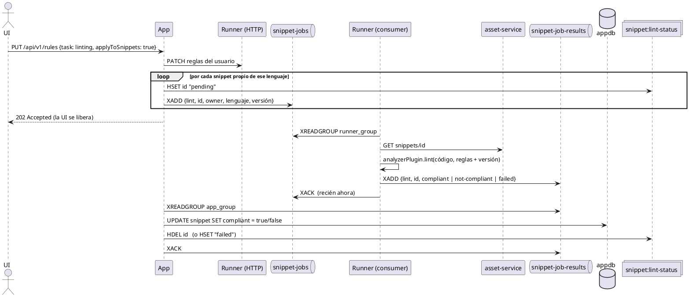
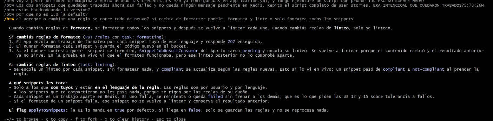

# Uso de Redis en SnippetSearcher: Streams, estado del linteo y compliance

## Índice
- [1. Para qué se usa Redis](#1-para-qué-se-usa-redis)
- [2. El problema: revalidar snippets cuando cambian las reglas](#2-el-problema-revalidar-snippets-cuando-cambian-las-reglas)
- [3. Claves de Redis y streams](#3-claves-de-redis-y-streams)
- [4. Esquema de los mensajes](#4-esquema-de-los-mensajes)
- [5. Compliant vs pending: qué va en la tabla y qué no](#5-compliant-vs-pending-qué-va-en-la-tabla-y-qué-no)
  - [5.1 ¿De qué depende `compliant`? Solo del linteo](#51-de-qué-depende-compliant-solo-del-linteo)
- [6. Cómo se ve en la UI](#6-cómo-se-ve-en-la-ui)
- [7. Flujos completos](#7-flujos-completos)
- [8. Garantías: ACK, reintentos y errores](#8-garantías-ack-reintentos-y-errores)
- [9. Relación con austral-ingsis/class-redis-streams](#9-relación-con-austral-ingsisclass-redis-streams)
- [10. Qué cambió y por qué (antes vs después)](#10-qué-cambió-y-por-qué-antes-vs-después)
- [11. Despliegue, migración y cómo inspeccionarlo](#11-despliegue-migración-y-cómo-inspeccionarlo)
- [12. Limitaciones conocidas](#12-limitaciones-conocidas)
- [13. Preguntas para repasar](#13-preguntas-para-repasar)

---

## 1. Para qué se usa Redis

Redis (`redis:7`, servicio `redis` del stack, volumen `redis-data`, puerto 6379 solo en la red
interna) cumple **dos** funciones:

1. **Mensajería con Redis Streams** entre App y Runner: trabajos de linteo y formateo en
   segundo plano, y sus resultados.
2. **Estado de los trabajos en curso**: un hash que dice qué snippets están `pending` o `failed`.

Redis **no lintea ni formatea nada**. Es solo el canal y la memoria compartida. El análisis lo hace
el Runner con los plugins de PrintScript.

---

## 2. El problema: revalidar snippets cuando cambian las reglas

Es el caso de uso de la clase *"Asynchronous processing with Redis Streams"*:

> 1. El usuario activa, desactiva o edita una regla de linteo.
> 2. Los snippets se procesan en segundo plano.
> 3. El usuario ve cuáles ya se revalidaron y cuáles siguen pendientes.

La presentación compara varios enfoques. Cada uno arregla algo del anterior:

| Enfoque | Qué hace | Por qué no alcanza |
| :--- | :--- | :--- |
| #1 | Lintear uno por uno dentro del request | Lento. Si se corta no se puede retomar. Pico de recursos. |
| #2 | Lo mismo en paralelo | Más rápido, pero sigue sin poder retomarse y satura al Runner. |
| #3 | En paralelo, guardando cada resultado | Hay resultados parciales, pero los otros problemas siguen. |
| #4 | Tabla de tareas con estado | Se puede retomar, pero no se sabe si un "Pending" está corriendo o murió. |
| #5 | Tabla de tareas + `202 Accepted` + proceso aparte | Libera el request, pero es complejo y acopla el servicio a los efectos. |
| **Final** | **Productor/Consumidor con Redis Streams + consumer groups** | **Es lo que implementamos.** |

¿Por qué **Streams** y no Pub/Sub?

| | Pub/Sub | Streams |
| :--- | :--- | :--- |
| Historial | No: si nadie escucha, el mensaje se pierde | Sí: el mensaje queda en el stream |
| Reintentos | Habría que inventarlos | Nativos: los mensajes sin ACK quedan en la PEL |
| Repartir entre réplicas | No: todos reciben todo | Sí: *consumer groups* |
| Orden y ritmo | No | Sí: se lee de a N, cuando el consumidor quiere |

---

## 3. Claves de Redis y streams

| Clave | Tipo | Quién escribe | Quién lee | Contenido |
| :--- | :--- | :--- | :--- | :--- |
| `snippet-jobs` | Stream | App (productor) | Runner, grupo `runner_group` | Trabajos: "linteá / formateá el snippet X" |
| `snippet-job-results` | Stream | Runner (productor) | App, grupo `app_group` | Resultados: "X dio compliant / not-compliant / formatted / failed" |
| `snippet:lint-status` | Hash | App | App | `snippetId → "pending" \| "failed"` |
| `snippet:{id}:{version}` | String | Runner | nadie (ver §12) | Última salida de ejecución |
| `execution:{run\|test}:{userId}:{snippetId}:status` | String (TTL 10 min) | Runner | Runner (`/executions/status`) | `RUNNING` · `WAITING` · `COMPLETED` · `ERROR` |
| `execution:{run\|test}:{userId}:{snippetId}:output` | List (TTL 10 min) | Runner | Runner (`/executions/status`) | Líneas impresas hasta ahora, en orden |

**Output en vivo (US #9 y #10).** El `POST` de una ejecución o de un test responde recién al terminar.
Mientras tanto, el Runner hace `RPUSH` de cada línea apenas el snippet la imprime, y la UI consulta cada
300 ms `GET /api/v1/snippets/{id}/executions/status?kind=run|test` para ir mostrándola. Esto vive en Redis
y no en memoria porque el Runner tiene 2 réplicas: la consulta puede caer en una réplica distinta de la que
ejecuta. Se eligió consulta periódica (*polling*) en lugar de SSE o WebSocket para no cambiar el contrato
del `POST /executions` (lo valida el test de Cypress *Can run snippets*) y porque no necesita sesión
pegada a una réplica. Si Redis falla, la ejecución sigue: solo se pierde la vista en vivo.

Configuración (`application.yml` de cada servicio):

```yaml
redis:
  streams:
    jobs: "snippet-jobs"
    results: "snippet-job-results"
    max-length: 10000          # XADD MAXLEN ~ 10000: el stream se recorta solo
    reclaim-interval-ms: 30000 # cada cuánto se buscan mensajes sin ACK para reintentar
```

---

## 4. Esquema de los mensajes

El **esquema del mensaje** es el único acoplamiento entre productor y consumidor. Está definido igual
en los dos servicios, en `jobs/SnippetJobMessages.kt`.

**Trabajo** (`snippet-jobs`):

| Campo | Ejemplo | Para qué |
| :--- | :--- | :--- |
| `task` | `lint` \| `format` | Qué hacer |
| `snippetId` | `e5edc5cc-…` | Key del snippet en el bucket |
| `userId` | `auth0\|670…` | **Dueño** del snippet: se aplican *sus* reglas |
| `language` | `printscript` | Las reglas son por lenguaje |
| `version` | `1.1` | Versión de PrintScript con la que se analiza |

**Resultado** (`snippet-job-results`):

| Campo | Ejemplo |
| :--- | :--- |
| `task` | `lint` \| `format` |
| `snippetId` | `e5edc5cc-…` |
| `outcome` | `compliant` \| `not-compliant` \| `formatted` \| `failed` |
| `detail` | Salida del analizador o motivo del fallo (truncado a 500 caracteres) |

---

## 5. Compliant vs pending: qué va en la tabla y qué no

La corrección que nos hicieron fue: *"en la tabla tiene que ir si es compliant o no, pero guardar
`pending` y los otros estados en la misma columna está mal"*.

Antes, la columna `snippet.compliance` (texto) mezclaba **dos cosas distintas**:

- El **resultado** del linteo, que es un dato del snippet: ¿cumple las reglas? → `compliant` / `not-compliant`.
- El **estado del procesamiento**, que es un dato del trabajo asíncrono, no del snippet:
  ¿hay un linteo en curso? ¿falló el último intento? → `pending` / `failed`.

Que un trabajo esté en la cola no es una propiedad del snippet: es transitorio y cambia segundos
después. Por eso ahora están **separados**:

| Qué | Dónde | Valores |
| :--- | :--- | :--- |
| Resultado del último linteo terminado | **Postgres**, columna `snippet.compliant` (`BOOLEAN`, nullable) | `true` cumple · `false` no cumple · `null` nunca se linteó |
| Estado del trabajo | **Redis**, hash `snippet:lint-status` | `pending` · `failed` · *(sin campo: no hay nada en curso)* |

El valor que ve la UI se **calcula** al responder (`jobs/Compliance.kt`):

| Estado en Redis | `compliant` en la tabla | La UI ve |
| :--- | :--- | :--- |
| `pending` | (cualquiera) | `pending` |
| `failed` | (cualquiera) | `failed` |
| — | `true` | `compliant` |
| — | `false` | `not-compliant` |
| — | `null` | `pending` *(el reconciliador lo va a encolar, ver §7.5)* |

Consecuencias de este diseño:

- **Cuando falla un relinteo no se pierde el último resultado bueno.** La tabla conserva `compliant = true`
  y Redis dice `failed`. Cuando se resuelve el problema, vale lo que diga la tabla.
- **Si Redis se cae, el listado sigue andando** con el último resultado guardado (`LintStatusStore.getAll`
  devuelve vacío ante un error).
- **No hay una "tabla de cola"** en Postgres (el antipatrón *database as a queue* del enfoque #4/#5):
  la cola es el stream y el estado efímero vive en Redis.

### 5.1 ¿De qué depende `compliant`? Solo del linteo

`compliant` responde una sola pregunta: **¿el código cumple las reglas de linteo de su dueño?** Lo dice la
User Story #5: *"mostrar si cada snippet es válido o no según las reglas de linteo que le apliquen"*.
El formateo no entra en esa cuenta:

| Tipo de regla | Ejemplos | ¿Afecta a `compliant`? |
| :--- | :--- | :--- |
| Linteo | `identifier_format` (camelCase), `mandatory-variable-or-literal-in-println`, `…-in-readInput` | **Sí**: el resultado del analizador es el valor de `compliant` |
| Formateo | espacios alrededor de `:` y `=`, saltos de línea antes y después de `println`, indentación | **No**: es estilo. Un snippet mal formateado puede ser `compliant` |

Por ejemplo, si a un snippet `compliant` le sacás un espacio, sigue `compliant`: le falta formato,
pero ninguna regla de linteo cambió de resultado.

Lo que importa es **qué cambia cada operación**:

| Operación | ¿Cambia el código? | ¿Cambia `compliant`? | Qué se encola |
| :--- | :--- | :--- | :--- |
| Cambiar reglas de **linteo** | No | Puede cambiar: mismo código, otras reglas | Solo `lint` |
| Cambiar reglas de **formateo** | **Sí**: el Runner reescribe el bucket | Puede cambiar: código nuevo | `format`, y **cuando termina**, `lint` |
| Editar el contenido (PATCH) | Sí | Puede cambiar | `lint` |
| Botón formatear (`POST /tasks/format`) | Sí | Puede cambiar | `lint` |

```
reglas de formateo ──▶ cambia el código ──▶ hay que volver a lintear
reglas de linteo   ──────────────────────▶ hay que volver a lintear
```

- **Cambiar reglas de linteo no reformatea:** el linteo solo lee el código y no lo modifica, y las reglas
  de formateo siguen iguales. No hay nada que formatear de nuevo.
- **Cambiar reglas de formateo sí relintea:** el `compliant` guardado se calculó sobre el código
  anterior. Una regla de linteo podría dar distinto sobre el código nuevo, así que ya no está garantizado.

**¿Por qué el linteo va *después* del formateo y no a la vez?** Si los dos trabajos se encolaran juntos,
otra réplica del Runner podría lintear el código **viejo** antes de que el formateo guarde el nuevo, y
`compliant` quedaría calculado sobre una versión que ya no existe. Por eso se encadenan:

1. El Runner formatea y guarda el código en el bucket.
2. Publica `formatted` en `snippet-job-results`.
3. `SnippetJobResultConsumer`, en el App, recién entonces encola el `lint` de ese snippet.

**El botón "Lint" del editor usa el mismo cálculo que la lista.** Antes usaba un linter propio de la UI
(`printscript-ui/src/utils/linter.ts`), más permisivo que el de PrintScript: en
`mandatory-variable-or-literal-in-println` solo rechazaba `println()` vacío. Por eso `println(num1 + num2)`
(el `example_ps` de los tests de Cypress) daba el toast verde *"passed linting"* y en la lista figuraba
`not-compliant`. El analizador real rechaza expresiones: *"println argument must be a literal or identifier"*.

Ahora el botón (y el auto-lint al guardar) llama a `POST /api/v1/snippets/{id}/tasks/lint` con el código
del editor en el body (`{content}`). El backend lo analiza con **el mismo analizador y las mismas reglas
(las del dueño)** que calculan `compliant`:

| Respuesta del backend | Toast de la UI | Lista |
| :--- | :--- | :--- |
| `SUCCESS: No issues were found` | verde *"passed linting"* | `compliant` |
| `ANALYSIS RESULTS: N issue(s) found: …` | amarillo *"Linting issues detected"* + el reporte | `not-compliant` |

Dos detalles:
- **Lintear desde el botón no guarda nada ni cambia `compliant`.** Sirve para probar el código del editor
  antes de guardarlo. `compliant` se recalcula recién al guardar, con el PATCH y el linteo asíncrono.
- **Un usuario con quien se compartió el snippet también puede lintear**, porque solo lee, y se usan las
  reglas del dueño. Formatear sí es solo del owner, porque guarda.

`linter.ts` queda solo como respaldo cuando no hay un snippet guardado al que preguntarle.

**¿Hoy se marca compliant?** Sí. Antes **no**: un snippet nuevo quedaba en `pending` para siempre,
porque solo se linteaba si el usuario cambiaba reglas con "aplicar a snippets". Ahora se lintea solo:
- al **crearlo**,
- al **editar su contenido**,
- al **cambiar las reglas de linteo**,
- después de un **formateo en segundo plano** (el contenido cambió),
- y los snippets viejos que nunca tuvieron resultado los encola el **reconciliador**.

---

## 6. Cómo se ve en la UI

La UI (`printscript-ui`) **ya mostraba los cuatro estados**. El contrato de la API no cambió:
`GET /api/v1/snippets` y `GET /api/v1/snippets/{id}` siguen devolviendo `compliance` como texto. El único
cambio en la UI es que el botón Lint ahora consulta al backend (§5.1), en `services/api.ts`
(`lintSnippet`), `utils/queries.tsx` (`useLintSnippet(id)`), `utils/snippetOperations.ts` y
`screens/SnippetDetail.tsx`.

| Dónde | Archivo | Qué muestra |
| :--- | :--- | :--- |
| Tabla de snippets, columna "Conformance" | `components/snippet-table/SnippetRow.tsx` | Chip: verde *Compliant*, rojo *Not Compliant*, rojo *Failed*, amarillo *Pending* (contorno) |
| Filtro "Conformance" | `components/snippet-table/SnippetTable.tsx` | All / Compliant / Not Compliant / Pending / Failed (filtra en el cliente) |
| Detalle del snippet | `screens/SnippetDetail.tsx` | Chip con el estado en mayúsculas |
| Tipo | `utils/snippet.ts` | `ComplianceEnum = 'pending' \| 'failed' \| 'not-compliant' \| 'compliant'` |

La UI **no refresca sola** mientras hay snippets en `pending`. El estado nuevo aparece al volver a
la pestaña (react-query refresca al recuperar el foco) o al recargar. Mejora posible: en `useGetSnippets`
(`utils/queries.tsx`), un `refetchInterval` que haga polling cada pocos segundos mientras algún snippet esté `pending`.

---

## 7. Flujos completos

### 7.1 Cambio de reglas de linteo (el caso de la clase)



### 7.2 Cambio de reglas de formateo
Igual que el anterior, pero con `task: format`. El consumidor del Runner formatea y **guarda el código nuevo
en el bucket**. Cuando el App recibe `formatted`, marca `formatter_applied` y **encola un linteo**, porque
el contenido cambió y el compliance anterior ya no vale. El linteo se encola recién cuando llega el resultado
del formateo, no al mismo tiempo, para que lea el código ya formateado (ver §5.1).

### 7.3 Crear un snippet
`UI → Runner PUT` (valida y guarda en el bucket) `→ App PUT /api/v1/snippets/{id}` (metadatos, permiso de
dueño) `→ App encola lint`. La UI lo ve `pending` y, a los segundos, `compliant` o `not-compliant`.

### 7.4 Editar el contenido
`UI → Runner PATCH` (guarda en el bucket) `→ App POST /api/v1/snippets/{id}/lint-jobs` con el JWT del usuario.
El App verifica el permiso, busca al **dueño** (sus reglas son las que valen) y encola.

### 7.5 Reconciliador (`jobs/PendingLintReconciler.kt`)
Cada 5 minutos (empieza 2 minutos después de arrancar) busca los snippets con `compliant = null` y los encola.
Usa `HSETNX`: si el snippet ya tiene estado (`pending` o `failed`) no lo vuelve a encolar. Así, con 2 réplicas
del App, solo una encola cada snippet. Cubre los snippets creados antes de este cambio y los casos donde el
`XADD` falló.

---

## 8. Garantías: ACK, reintentos y errores

### ACK manual = *at-least-once*
Un mensaje se confirma (`XACK`) **solo si se procesó bien**. Si el proceso tira una excepción o la réplica
muere a la mitad, el mensaje queda en la **PEL** (*Pending Entries List*) del grupo.

### Recuperación de pendientes (`RedisStreamConsumer.reclaimPending`)
Ojo con un malentendido común: **Redis no reasigna solo** los mensajes de la PEL. Si nadie los reclama,
quedan pendientes para siempre. Por eso cada 30 s cada réplica:

1. `XPENDING`: lista los mensajes sin ACK del grupo.
2. Para los que llevan **más de 60 s** sin confirmarse, `XCLAIM` se los asigna a sí misma. Si otra réplica
   lo tomó primero, `XCLAIM` no devuelve nada y se saltea.
3. Lo reprocesa. Si ya se entregó **3 veces**, va a `onDeadLetter`: el Runner publica `failed` y se confirma,
   para no reintentarlo para siempre.

Como la entrega es *al menos una vez*, un mensaje puede procesarse dos veces. No es un problema porque las
operaciones son **idempotentes**: lintear dos veces da el mismo resultado y formatear un código ya
formateado no lo cambia.

### Errores permanentes vs transitorios (consumidor del Runner)

| Error | Tipo | Qué se hace |
| :--- | :--- | :--- |
| El snippet no tiene contenido en el bucket | Permanente | Resultado `failed` + ACK |
| Código que el analizador no puede parsear | Permanente | `failed` + ACK |
| Usuario sin reglas configuradas | Permanente | `failed` + ACK |
| Mensaje mal formado | Permanente | Se descarta + ACK |
| Asset service o base caídos, error al guardar | **Transitorio** | Excepción → sin ACK → reintento → `failed` si se agotan |

Reintentar un error permanente no tiene sentido, y no reintentar uno transitorio pierde trabajo.
Por eso se distinguen.

### Otras protecciones
- **`XGROUP CREATE ... MKSTREAM`:** el grupo se crea aunque el stream todavía no exista.
- **`NOGROUP` al leer** (Redis reiniciado sin datos): se vuelve a crear el grupo automáticamente.
- **Redis caído:** el listener no se cancela (`cancelOnError = false`) y espera 5 s entre intentos (sin loop caliente).
- **`MAXLEN ~ 10000`** en cada `XADD`: el stream conserva historial pero no crece sin límite.
- **Ritmo de procesamiento:** cada réplica procesa **de a un mensaje** (lock en el consumidor base). Para ir
  más rápido se agregan réplicas del Runner y el consumer group las reparte solo.
- **Consumer name = hostname** del contenedor: en Swarm cada tarea tiene uno propio.

---

## 9. Relación con austral-ingsis/class-redis-streams

El repo de la cátedra define un `RedisStreamProducer` (con `emit(value)`) y un `RedisStreamConsumer`
abstracto (crea el grupo en `@PostConstruct`, se suscribe y delega en `onMessage`). Nuestro código
**sigue esa misma estructura** (`redis/RedisStreamProducer.kt` y `redis/RedisStreamConsumer.kt`, una copia
en App y otra en Runner):

| | class-redis-streams | Nuestro código |
| :--- | :--- | :--- |
| Productor base con `emit` | Sí | Sí, más `MAXLEN ~` |
| Consumidor base abstracto con `onMessage` | Sí | Sí, más `onDeadLetter` |
| Crea el grupo al arrancar | Sí | Sí, con `MKSTREAM`, y lo recrea ante `NOGROUP` |
| Nombre del consumidor | hostname | hostname |
| Lectura | `StreamReceiver` reactivo | `StreamMessageListenerContainer` (equivalente bloqueante: el proyecto es Spring MVC) |
| ACK | **`receiveAutoAck`**: confirma al leer | **Manual**: confirma al terminar bien |
| Reintentos | No | `XPENDING` + `XCLAIM` + dead letter |

Las dos diferencias importantes son a propósito. Con *auto-ack*, si el proceso falla después de leer, el
mensaje se pierde, y eso contradice la ventaja de los Streams que muestra la presentación ("los mensajes
se pueden reintentar").

No se importó la librería `org.austral.ingsis:redis-streams` como dependencia: es pequeña, el ACK automático
no nos sirve, y está escrita para el `StreamReceiver` reactivo.

---

## 10. Qué cambió y por qué (antes vs después)

| # | Antes | Problema | Después |
| :--- | :--- | :--- | :--- |
| 1 | `compliance` (texto) mezclaba resultado y estado | Lo que nos corrigieron (§5) | `compliant BOOLEAN` en la tabla + `pending`/`failed` en Redis |
| 2 | Nunca se marcaba `pending` al encolar | La UI no distinguía pendientes de revalidados | `HSET pending` antes de cada `XADD` |
| 3 | Solo se linteaba al cambiar reglas | Un snippet nuevo o editado quedaba `pending` para siempre | Lint al crear, editar y formatear, más el reconciliador |
| 4 | ACK en el `finally` | Se confirmaba aunque fallara: ningún reintento | ACK solo si terminó bien |
| 5 | Consumer `runner_consumer_<UUID>` sin reclamar pendientes | Lo que tenía una réplica muerta quedaba en la PEL para siempre | Hostname + `reclaimPending` |
| 6 | `createGroup` sin `MKSTREAM` y error tragado | Si el Runner arrancaba antes del primer `XADD`, el grupo no existía y nunca consumía | `MKSTREAM` + recreación ante `NOGROUP` |
| 7 | El Runner avisaba con `PATCH /api/v1/snippets/{id}/status` **sin autenticación** | Cualquiera podía marcar cualquier snippet como compliant. Además el Runner conocía al App | Stream de resultados. Endpoint eliminado |
| 8 | `POST /api/v1/testing` sin autenticación | Cualquiera podía meter mensajes en el stream | Eliminado (era de debug) |
| 9 | El trabajo no llevaba la `version` | Se analizaba con 1.0: los snippets 1.1 (`const`, `if`) daban error | `version` viaja en el mensaje |
| 10 | Compliance detectado buscando `"Error:"` en lo que devolvía el plugin | Sin issues, el plugin devuelve **el propio código**: `println("Error: x")` daba `failed` | `AnalyzerPlugin.lint()` clasifica la **salida cruda** del analizador |
| 11 | El analizador redirigía `System.out` sin sincronizar | Dos análisis a la vez mezclaban salidas | Lock alrededor de la captura |
| 12 | Cambiar reglas de un lenguaje encolaba todos los snippets | Trabajo inútil con reglas de otro lenguaje | Solo los del lenguaje de las reglas |
| 13 | Formatear no volvía a lintear | El compliance quedaba viejo después de cambiar el código | El App encola el lint al recibir `formatted` |
| 14 | `XADD` sin límite | El stream crecía indefinidamente | `MAXLEN ~ 10000` |
| 15 | `PUT /rules` devolvía `200` | La revalidación todavía no ocurrió | `202 Accepted` si se encolaron trabajos |
| 16 | El test del consumidor estaba **todo comentado** | No probaba nada | Tests reales: consumidor base (ACK, reintentos, dead letter, NOGROUP), productor, consumidores, estado, reconciliador, linteo real con el analizador |

---

## 11. Despliegue, migración y cómo inspeccionarlo

**No hay que tocar `docker-stack.yml`.** La configuración nueva viene en el `application.yml` de cada imagen.

Migración de la base del App:
- Hibernate (`ddl-auto: update`) **agrega** la columna `compliant`, pero no borra las viejas (`compliance`,
  `linter_applied`). Para dejar la tabla limpia está `db/migrations/001-compliant-boolean.sql`: agrega
  `compliant`, copia los resultados reales (`compliant` → `true`, `not-compliant` → `false`) y borra las
  columnas viejas. Es idempotente y corre en una transacción:
  ```bash
  docker exec -i <contenedor-appdb> psql -U app -d appdb < db/migrations/001-compliant-boolean.sql
  ```
  Se probó sobre una base local con 69 snippets viejos: todos estaban en `pending` (el bug original) y
  quedaron en `null`; el reconciliador los linteó solo: 45 compliant, 16 not-compliant y 10 failed
  (8 de usuarios sin reglas, 1 sin dueño en el AccessManager y 1 cuyo código no parsea).
- `db/app-init/01-init-snippet.sql` ya crea la tabla con `compliant` (se usa solo con una base nueva).
- Los snippets existentes arrancan con `compliant = null`. El reconciliador los encola a los ~2 minutos.

El stream viejo `jobs` (y su grupo) queda huérfano. Se puede borrar:

```bash
docker exec -it $(docker ps -qf name=snippetsearcher_redis) redis-cli
DEL jobs
```

Comandos útiles dentro de `redis-cli`:

```bash
XLEN snippet-jobs                                  # cuántos mensajes guarda el stream
XINFO GROUPS snippet-jobs                          # grupo runner_group: consumers, pending, last-delivered-id
XINFO CONSUMERS snippet-jobs runner_group          # cada réplica del Runner y sus pendientes
XPENDING snippet-jobs runner_group - + 10          # mensajes sin ACK: id, consumer, idle, entregas
XRANGE snippet-job-results - + COUNT 5             # últimos resultados
HGETALL snippet:lint-status                        # qué snippets están pending / failed ahora
```

---

## 12. Limitaciones conocidas

- **Cache de ejecución que nadie lee:** `ExecutionService` guarda la salida de cada ejecución en
  `snippet:{id}:{version}` (sin TTL) y nunca la lee. Habría que borrarlo o ponerle TTL.
- **Esquema duplicado:** `SnippetJobMessages.kt` y la base de streams están copiados en App y Runner. Si se
  cambia un campo hay que cambiarlo en los dos. Una librería compartida, como hace la cátedra, lo evitaría.
- **Salida del analizador por `System.out`:** el lock evita mezclar dos análisis, pero un log de otro hilo
  impreso justo en ese momento podría colarse en la salida capturada. Lo ideal es que la librería de
  PrintScript devuelva el resultado en lugar de imprimirlo.
- **`PUT /api/v1/snippets/*` del App sigue público**, porque lo llama el Runner sin JWT al crear. No es de
  este cambio, pero conviene protegerlo (por ejemplo con un secreto entre servicios).
- **La UI no hace polling** del estado `pending` (§6).
---

## 13. Preguntas para repasar

1. **¿Por qué `pending` no va en la tabla?** Es el estado de un trabajo asíncrono, no un dato del snippet.
   La tabla guarda el resultado (`compliant` true/false) y el estado vive en Redis.
2. **¿Qué ve la UI si un relinteo falla?** `failed`, pero la tabla conserva el último resultado bueno.
3. **¿Qué pasa si se cae una réplica del Runner a mitad de un linteo?** El mensaje queda sin ACK en la PEL.
   A los 60 s otra réplica lo toma con `XCLAIM` y lo procesa.
4. **¿Y si falla siempre?** A la tercera entrega va a *dead letter*: se publica `failed` y se confirma.
5. **¿Por qué ACK manual y no automático como en el ejemplo de la cátedra?** Con auto-ack el mensaje se da
   por procesado al leerlo y se pierde si el proceso falla.
6. **¿Cómo se reparte el trabajo entre las 2 réplicas del Runner?** Están en el mismo consumer group
   (`runner_group`) y Redis le entrega cada mensaje a una sola.
7. **¿Por qué el Runner no le avisa el resultado al App por HTTP?** Para desacoplarlos: el Runner publica en
   `snippet-job-results` sin saber quién lo lee. Además el endpoint HTTP que había no tenía autenticación.
8. **¿Puede procesarse dos veces el mismo mensaje? ¿Importa?** Sí (*at-least-once*). No importa porque
   lintear y formatear son idempotentes.
9. **¿Por qué el trabajo lleva `userId` y `version`?** Las reglas son del dueño del snippet y el analizador
   necesita la versión de PrintScript: sin ella, un snippet 1.1 fallaba.
10. **¿Qué es la PEL?** La *Pending Entries List*: los mensajes entregados a un consumidor del grupo que
    todavía no recibieron `XACK`.
11. **¿De qué depende `compliant`?** Solo de las reglas de linteo. Las de formateo son de estilo: un snippet
    mal formateado puede ser `compliant`.
12. **¿Por qué al cambiar reglas de formateo se relintea, pero al cambiar las de linteo no se reformatea?**
    El formateo cambia el código y el `compliant` guardado se calculó sobre el anterior. El linteo no cambia
    el código y las reglas de formateo siguen iguales: no hay nada que reformatear.
13. **¿Por qué el linteo se encola después del formateo y no a la vez?** Para que no lea el código viejo
    antes de que el formateo guarde el nuevo.
14. **¿Por qué antes un snippet podía pasar el botón "Lint" y figurar `not-compliant`?** El botón usaba un
    linter de la UI más permisivo. Ahora llama al backend, que usa el mismo analizador y las mismas reglas
    que `compliant`, así que no se pueden contradecir.

